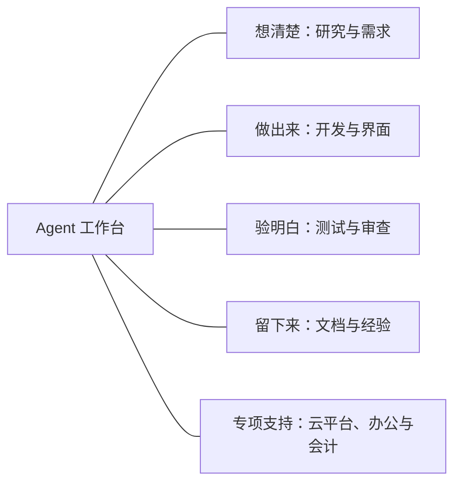

# 这个工作台能帮你做什么

`agent-workbench` 是面向持续开发和维护的工程工作台。它把需求思考、软件设计、Agent 协作、测试审查和知识积累放在同一套可组合的方法中，让你既能处理一个具体问题，也能推进跨模块、跨会话的复杂项目。

你可以带着一堆尚未理清的材料来探索方向，也可以拿着明确需求直接开发；可以只审一个改动、排查一次故障，或把完成的工作整理成以后能用的知识。涉及租户、权限、数据和外部系统时，工作台帮助明确边界并核对证据；具体采用哪些能力，取决于当前问题。

这里介绍仓库提供的能力。Skills 是可按需调用的工作方法，插件将相关方法与工具组合起来；实际执行还需要对应宿主、工具、账号和项目权限。安装方式见 [README](../README.md) 与 [安装规范](workbench-design/04-install-spec.md)。

这些是可按需选用的能力板块，不是必须依次执行的步骤。

## 把想法变成清楚的需求

当材料很多、说法矛盾，或你还没有决定方向时，工作台可以先整理已有认识、查证关键事实、比较可行方案。它会区分“用户已经确认的承诺”“有依据的事实”和“还只是候选的办法”，避免一开始就把猜测写进正式方案。

讨论可以通过追问暴露隐藏取舍，也可以先质疑方案的前提、让多个参与方独立提出意见，或用一个可操作的原型帮助你判断。项目中的术语和重要设计理由可以同步澄清，让后续沟通不必反复解释同一件事。

方向成熟后，正式需求对齐形成两类结果：Decision 说明为什么做、选什么方向；Spec 明确系统应该如何表现，以及权限、数据、失败恢复等共享约定。已有清晰需求时，可以直接进入对应阶段。

例如：“这些调研材料都放在 investigations 里，先帮我判断有哪些现实可行的方向。”可以从 [req-discover](../skills/req-discover/SKILL.md) 开始；需要正式方案时，由 [req-align](../plugin-marketplace/plugins/impl-package/skills/req-align/SKILL.md) 承接。

## 设计并推进复杂开发

面对一个功能越来越难改的代码库，工作台可以审视模块边界、依赖和接口，寻找用较小接口承载完整行为的设计。进入实施时，将目标组织成能交付、能验证的工作，明确哪些可以独立推进，哪些需要先稳定共同约定。

多 Agent 协作由 [Dispatcher](../skills/dispatcher/SKILL.md) 根据实际依赖与资源安排：适合并行的研究、实现和验证可以同时进行；文件、数据库、端口和测试数据存在冲突时，需要隔离或排序。前后端执行者依据同一共享合同工作，主控负责核对返回、处理缺口并继续安排。

需要持续跟踪的复杂变更，可以使用 [Impl-Package](../plugin-marketplace/plugins/impl-package/skills/impl-package/SKILL.md) 组织需求、计划、执行证据和验收。文件化规划、显式任务队列、进度页面以及交接能力，则帮助保存当前认识、展示剩余工作，并让新会话接续已有成果。

你得到的不只是代码，还包括哪些结果已经验证、哪里仍有阻塞、下一步能做什么。工作台也提供与 Codex、Claude、Grok 等执行工具协作的方法，以及独立复核渠道；具体工具是否可用由运行环境决定。

## 验证结果并控制风险

“测试全绿”未必意味着用户操作真的可用。工作台帮助选择能证明当前结果的验证方式：用测试驱动开发建立快速反馈，为组件或接口补充测试，在跨模块或真实环境边界检查完整行为。

出现故障时，[diagnosing-bugs](../skills/diagnosing-bugs/SKILL.md) 引导先建立可区分成功与失败的反馈，再缩小问题、提出假设、观察并修复，最后保留回归证据。结果可以进一步整理成简明的根因和修复说明。

审查覆盖实现正确性、可维护性、仓库规范和需求忠实度；涉及权限、持久化数据、并发或外部副作用时，增加对应的安全检查。[do-review](../plugin-marketplace/plugins/impl-package/skills/do-review/SKILL.md) 组织独立审阅者检查明确版本的改动，并核对发现的问题是否得到解决。

跑端到端验收、浏览器走查或演示前，[validation-harness](../skills/validation-harness/SKILL.md) 帮助搭建或审计可重放的验证环境：一条命令建出准备状态，每次运行使用自己的业务数据和新对象，起点检查与过程证据随运行保留，走查因此可以从零重来。

这些能力帮助你区分“已实现”“已在局部验证”和“已满足交付条件”。验证围绕实际风险展开，模拟结果、旧版本测试或局部成功不会自动成为真实系统已通过的证明。

## 改善产品界面与使用体验

界面工作既包括视觉设计，也包括用户是否能看懂、找到并完成操作。工作台支持页面与组件设计、布局和文案调整、交互细节打磨，以及根据截图和实际浏览器反馈持续迭代。

方案尚未确定时，可以制作不同方向的临时原型；需要确认它是否适合现有产品时，可以在真实应用外壳中制作使用固定示例数据的预览。这样能较早讨论形状和状态，再接入业务流程。

现有能力还覆盖表单、列表、弹层、空状态、响应式和可访问性等常见体验问题，以及 React/Next.js 性能、国际化初始化和翻译质量检查。多语言支持不仅检查词条是否存在，也关注界面是否出现错误语言、格式是否符合当地习惯。

代表入口包括 [impeccable](../skills/impeccable/SKILL.md) 的界面改进、[preview-design](../skills/preview-design/SKILL.md) 的预览选择，以及 [i18n-advisor](../skills/i18n-advisor/SKILL.md) 的国际化检查；浏览器交互能力负责查看和操作实际页面。

## 让完成的工作产生长期价值

一次任务结束后，值得留下的不只有提交记录：还可能有新的业务约定、模块行为、有效的排障方法，或能避免重复摩擦的工具改进。

[knowledge-manager](../skills/knowledge-manager/SKILL.md) 将这些结果分别处理：稳定的产品和系统语义回到正式文档；非显然的实现、验证和恢复经验进入实践知识；环境问题形成检查、工具或信息入口的改进建议。它核对当前依据，避免把临时猜测和过期 workaround 当成长期规则。

也可以只处理其中一类知识，或从源码整理技术文档和架构说明。新会话接手时，交接材料帮助它找到当前目标、有效结论、证据和剩余工作，而不是重新阅读完整聊天历史。

最终得到的是后续开发能实际复用的资料。知识文档的更新与代码、CI、权限等环境修改各有授权边界，复盘建议不会自动变成环境变更。

## 支持专业场景和日常协作

除了通用开发，仓库还维护了几类专项方法：

- **Azure 应用与消息系统**：支持容器镜像构建、Container Apps 部署，以及 Service Bus 的权限、消息处理、重试、死信、监控和排障。通过 [Azure 入口](../skills/azure-skills/using-azure/SKILL.md) 按当前问题读取相应方法。
- **Lark International 办公协作与集成**：围绕文档、知识库、表格、多维表格、消息、日历、任务、审批和会议资料开展操作，也支持 SDK、事件和工作流集成。[Lark 入口](../skills/lark-skills/using-lark/SKILL.md) 区分一次性操作与应用代码集成；其服务范围是国际版 Lark。
- **德国 DATEV 会计与税务知识**：查询科目、税码和导出规则，区分专业依据、具体客户配置与软件实际能力。[DATEV 入口](../skills/datev-tax-accounting/SKILL.md) 帮助明确适用条件和证据缺口，不用通用知识替代客户已批准的会计政策。
- **Git、Issue 与任务协作**：管理分支、提交和冲突，起草与整理 Issue，核对 Issue/PR 关系和状态，也能把任务与讨论记录到本地任务管理库。涉及远程发布的动作遵循各入口的授权约定。
- **把技术工作讲清楚**：将复杂结果改写成决策摘要、交接说明、进度页面或可分享的 HTML 变更解释；也可通过持续教学帮助用户理解概念和技能。[explain-diff-html](../skills/explain-diff-html/SKILL.md) 是将代码变化转化为可阅读讲解的一个例子。

这些专项能力提供工作方法、参考资料和部分工具，访问外部服务仍需要实际账号、连接和权限。仓库里的支持范围不等同于任何目标项目已经完成相应集成。

## 在不同宿主上使用和维护同一套方法

工作台将可复用内容集中维护，再通过不同宿主支持的方式使用：独立 Skills 按需链接；多能力套件通过插件安装；Agent 定义和适配工具提供相应执行角色。仓库包含 Codex、Claude、Grok、ZCode 等宿主的相关支持，具体安装和加载范围以各自配置为准。

其中，**Impl-Package** 将正式需求对齐、实施规划、执行跟踪、独立审查和知识回刷组合起来。它与独立的研究、探索、调度、UI 和知识能力协作，让复杂项目可以保留一致的工作依据。

仓库也包含 **DSH 原生适配**：[`dsh-impl-package`](../plugin-marketplace/plugins/dsh-impl-package/README.md) 将现有任务包能力接入 DSH 的命令、工具和会话机制；[`dsh-dispatch-scan`](../plugin-marketplace/plugins/dsh-dispatch-scan/README.md) 在执行步骤前提醒检查可推进的并行工作。它们使用自己的插件配置，不应将主 marketplace 的安装方式理解为安装了所有适配。

工作台自身也可以迭代：发现和审查第三方 Skills、编写或改进本地 Skills、记录已确认的优化偏好，并核对源文件与宿主安装态的差异。[setup-workbench](../skills/setup-workbench/SKILL.md) 支持安装态检查及其明确支持的更新流程；链接工具在冲突时保留现有内容并报告。

从一次具体问题开始，使用所需的能力即可。关于安装、更新和维护，请回到 [README](../README.md)；各能力的精确行为和边界由对应 Skill 或插件说明维护。
