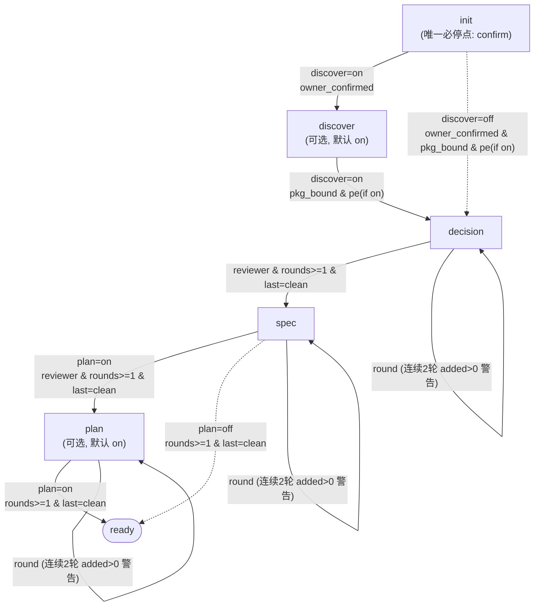

# Kickoff

本 skill 只做编排。主链、输入契约、常驻角色登记、审阅分诊与阶段门禁都由
`scripts/kickoff.py` 强制；各阶段“怎么做”交给被调用的 skill 与审阅者。

## 职责分工

- **kickoff**：编排主链、校验输入契约、登记常驻角色、记录分诊轮次、阶段门禁、按阶段注入硬原则。
- **impl-package**：单阶段方法（`req-align` 出 Decision/Spec，`impl-planning` 出 Plan）。
- **审阅者**：独立只读，负责挑全漏洞，不替 Owner 做业务取舍。
- **主控 + PE**：负责四类分诊（往下钻 / 根部裁剪+人工兜底 / 交 PE / 驳回）与根部裁剪。

## 主链

<!-- BEGIN:PIPELINE_DIAGRAM -->

<!-- END:PIPELINE_DIAGRAM -->

两段式落点：`init --slug` 先写暂存 `output/kickoff/<slug>.json`；`bind-pkg` 再迁到
`<pkg>/kickoff-state.json` 并绑定 `pkg_dir`。除 `init` / `diagram` 外，所有命令用 `--pkg <dir>` 或
`--state <path>` 指定状态文件。

## 命令

脚本路径：`~/.claude/skills/kickoff/scripts/kickoff.py`（下以 `KICKOFF` 代称）。

```bash
# 1. 初始化（--pkg 直接绑定，或 --slug 暂存）
python ~/.claude/skills/kickoff/scripts/kickoff.py init --slug <slug> \
  --research <path|none> [--research ...] --prototype <path|none> \
  [--discover on|off] [--pe on|off] [--plan on|off] [--goal ...] [--docs ...]

# 2. 复述对齐后，Owner 确认（唯一必停点）
python ~/.claude/skills/kickoff/scripts/kickoff.py confirm --state <path> --note "..."

# 3. 探索阶段登记常驻 PE
python ~/.claude/skills/kickoff/scripts/kickoff.py register --state <path> --role pe --agent-id <id>

# 4. 暂存状态迁入包目录
python ~/.claude/skills/kickoff/scripts/kickoff.py bind-pkg --state <path> --pkg <dir>

# 5. 设计/计划：每轮审阅后记录分诊（--verdict 默认 open，复验清零后记 clean；补录历史阶段加 --backfill）
python ~/.claude/skills/kickoff/scripts/kickoff.py register --pkg <dir> --role reviewer --agent-id <id>
python ~/.claude/skills/kickoff/scripts/kickoff.py round --pkg <dir> --stage decision|spec|plan \
  --added N --cut N --pe N --rejected N --verdict open|clean --summary "本轮分诊摘要"

# 6. 过门进入下一阶段（门禁不满足会一次列出全部原因；可选 --artifact 登记产出路径）
python ~/.claude/skills/kickoff/scripts/kickoff.py advance discover|decision|spec|plan|ready --pkg <dir> [--artifact <path>]

# 7. 随时查看状态与下一步有效命令
python ~/.claude/skills/kickoff/scripts/kickoff.py status --pkg <dir>

# 8. 从声明式 PIPELINE 自动生成 / 同步主链 Mermaid 图（改动 PIPELINE 后执行）
python ~/.claude/skills/kickoff/scripts/kickoff.py diagram
python ~/.claude/skills/kickoff/scripts/kickoff.py diagram --sync-md ~/.claude/skills/kickoff/SKILL.md
python ~/.claude/skills/kickoff/scripts/kickoff.py diagram --sync-md ~/.claude/skills/kickoff/SKILL.md --check
```

## 门禁与熔断（由 CLI 强制，纯流程不解析下游文档）

- 所有 `advance` 前必须 `owner_confirmed=true`。
- 进 `decision` 前必须已绑定包目录；`pe=on` 时必须已登记 PE。
- 进 `spec` 前：已登记 reviewer、decision 至少 1 轮分诊且最后一轮 `--verdict clean`。
- 进 `plan` / `ready` 前：对应阶段至少 1 轮分诊且最后一轮 `--verdict clean`；`plan=off` 时从 `spec` 直接到 `ready`。
- `round` 默认校验 `--stage` 与当前阶段一致（防记串阶段）；补录历史阶段需显式传 `--backfill`。
- 替换已登记的 `pe` / `reviewer` 时 CLI 打出 `[警告]`，防止误开新代理破坏续用原则。
- 若传入 `--artifact <path>`，CLI 仅校验路径存在并登记到状态文件，不假设文件名也不解析文档内容（文档结构与内容由各阶段 skill 自行校验）。
- 同一阶段连续 2 轮都 `added > 0` → CLI 打出 `[收敛警告]`，停下回看原型并过 PE 判断能否根部裁剪；同一阶段进入第 4 轮及以上 → CLI 打出 `[轮次提醒]`，确认是在收尾而非细节拉锯。

各阶段硬原则（init / discover / decision / spec / plan / ready）由 `advance` 与 `status`
自动打印，按其执行即可。

## 升级规则

只在 PE 也定不了的业务取舍、范围扩大、需要外部写入（push、PR、Staging/生产）时停下找 Owner。
其余自行推进，最后按 `ready` 原则用人话统一汇报。
